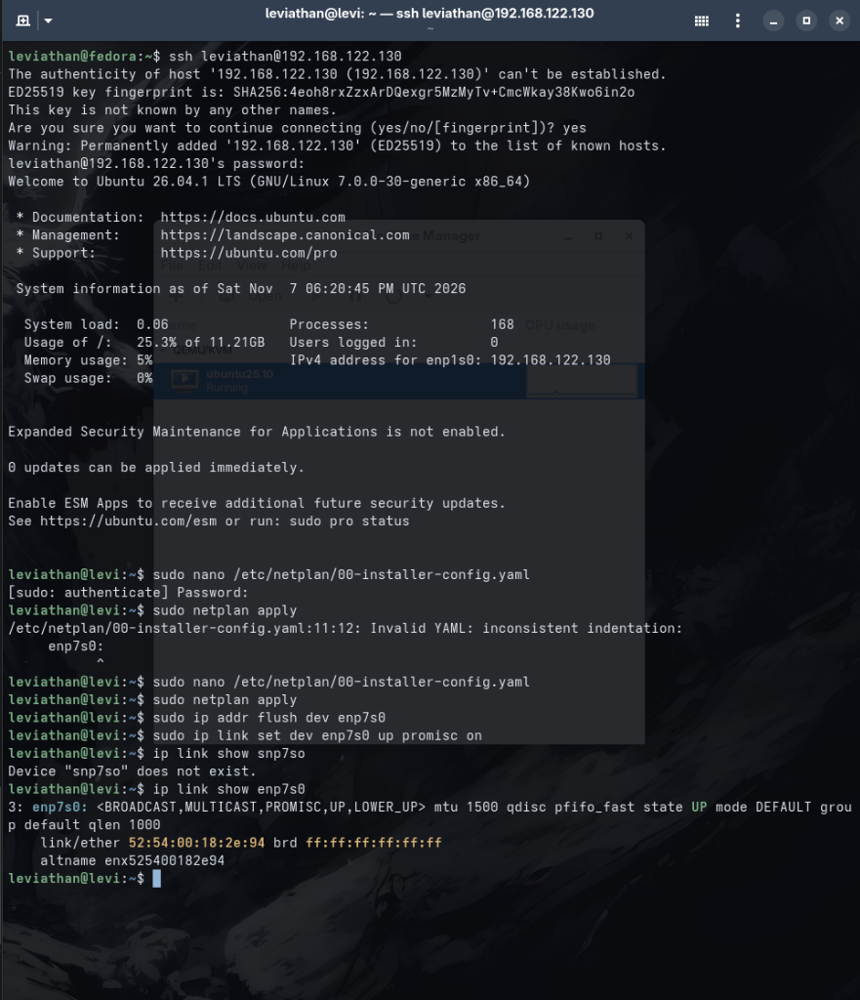
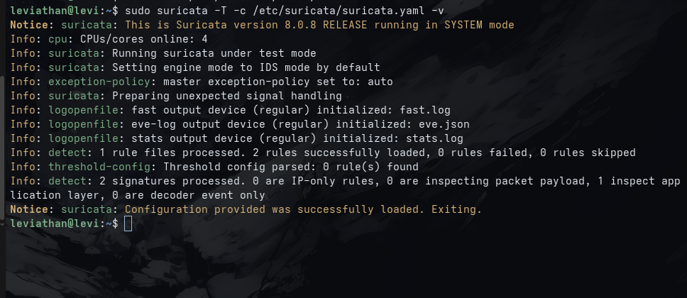
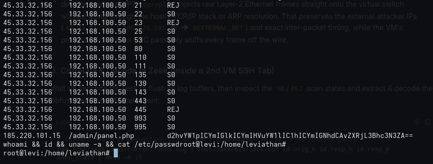
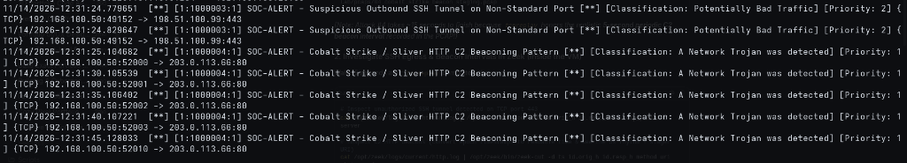
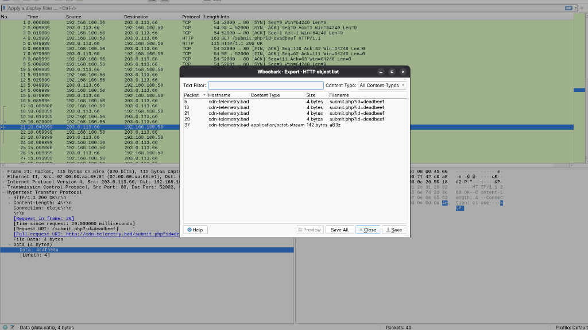
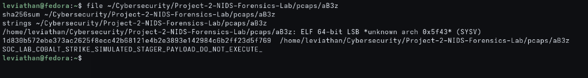
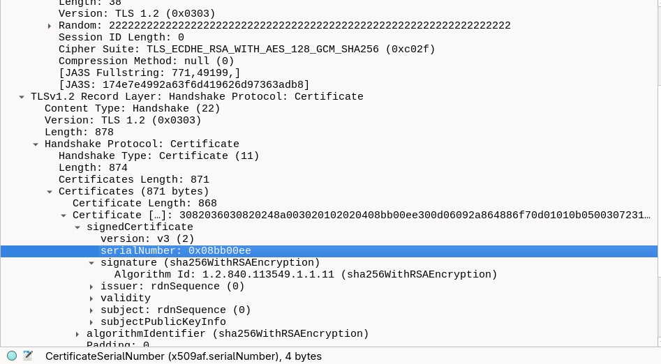
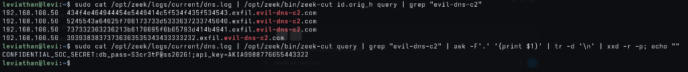

# Production Network Intrusion Detection (NIDS) & Network Forensics Lab

[-red.svg)](https://suricata.io/)
[-blue.svg)](https://zeek.org/)
[](https://www.linux-kvm.org/)
[](https://fedoraproject.org/)
[](https://attack.mitre.org/)

A production-grade Blue Team network security monitoring environment built to intercept, detect, and forensically analyze advanced cyber attack vectors in real time. Deployed across a dual-homed virtualization architecture using hardware-tuned Linux virtual switching, zero-copy packet rings, custom Suricata signatures, and deep protocol-aware Zeek telemetry.

---

## Core Documentation & Reference Guides

- **[Project 2: Complete Attack Vectors & OWASP/MITRE Reference Guide](Project2NIDSAttacksandOWASPGuide%20(1).pdf)**: Comprehensive breakdown of the 6 attack vectors, MITRE ATT&CK vs. OWASP Top 10 mappings, Suricata signature mechanics, Zeek telemetry fields, and Wireshark forensic filters.
- **[Lab Implementation Workbook](docs/LAB_WORKBOOK.md)**: Chronological step-by-step engineering journal detailing hypervisor plumbing, dual-NIC setup, sensor hardening, rule authoring, and forensic replay execution.
- **[Technical Case Study: Docker vs. Libvirt Firewall Collision](docs/DOCKER_FIREWALL_CASE_STUDY.md)**: Deep dive into diagnosing and resolving the host nftables `FORWARD drop` collision caused by Docker Engine on Fedora Workstation.
- **[Senior SOC Interview Defense Guide](docs/INTERVIEW_DEFENSE_GUIDE.md)**: Technical breakdown of detection filter mechanics, TCP flag masking (`flags:S,12`), flow state tracking, NIC offload impacts, and Zeek vs. Suricata architecture.

---

## Architecture & Network Topology

```text
┌────────────────────────────────────────────────────────────────────────┐
│                        FEDORA WORKSTATION (HOST)                       │
│   Hypervisor: QEMU/KVM managed via libvirt / virt-manager              │
│   Traffic Engine: tcpreplay, wireshark, tshark, nftables               │
│                                                                        │
│   ┌───────────────────────────┐     ┌──────────────────────────────┐   │
│   │   virbr0 (NAT / default)  │     │   virbr1 (soc-bridge / TAP)  │   │
│   │   Subnet: 192.168.122.0/24│     │   Subnet: 192.168.100.0/24   │   │
│   │   [Management & Egress]   │     │   [Sterile Sniffing Wire]    │   │
│   └─────────────┬─────────────┘     └──────────────┬───────────────┘   │
└─────────────────┼──────────────────────────────────┼───────────────────┘
                  │                                  │
                  │ vnet0 (DHCP)                     │ vnet1 (No IP / Promisc)
                  ▼                                  ▼
┌─────────────────┴──────────────────────────────────┴───────────────────┐
│                    UBUNTU SERVER SENSOR VM                             │
│                         Hostname: leviathan@levi                       │
│                                                                        │
│   enp1s0: 192.168.122.130 (SSH management, package updates)            │
│   enp7s0: Passive Tap (Promiscuous mode, Hardware Offloads OFF)         │
│                                                                        │
│   ┌───────────────────────────┐     ┌──────────────────────────────┐   │
│   │   Suricata NIDS 8.0.8     │     │   Zeek NSM 9.0.1             │   │
│   │   - AF-PACKET ring buffer │     │   - Protocol state engine    │   │
│   │   - 6 Custom Threat Rules │     │   - conn, http, dns, ssl logs│   │
│   │   - fast.log / eve.json   │     │   - zeek-cut / jq analytics  │   │
│   └───────────────────────────┘     └──────────────────────────────┘   │
└────────────────────────────────────────────────────────────────────────┘
```

---

## Threat Detection Coverage Matrix & Forensic Results

| # | Attack Vector | MITRE ATT&CK | OWASP 2025 | Suricata Signature (`sid`) | Zeek Log & Forensic Evidence | Status |
|---|---|---|---|---|---|---|
| **1** | **Half-Open TCP SYN Scan** | `T1046` | A02 | `flags:S,12; flow:stateless; detection_filter:count 20, seconds 5` (`1000001`) | `conn.log`: Rate-burst detected, connection states `S0` and `REJ` | Verified |
| **2** | **Obfuscated Base64 User-Agent** | `T1071.001` | A05, A09 | `http.user_agent; pcre:"/^[A-Za-z0-9+/]{30,}={0,2}$/"` (`1000002`) | `http.log`: Decoded payload `whoami && id && uname -a && cat /etc/passwd` | Verified |
| **3** | **Unauthorized SSH Egress Tunnel** | `T1572` | A01 | `![22]; flow:established,to_server; content:"SSH-2.0-"; depth:8` (`1000003`) | `ssh.log`: SSH protocol banner detected outbound over non-standard port 443 | Verified |
| **4** | **Cobalt Strike / Sliver C2 Beacon** | `T1071.001`, `T1041` | A08 | `http.method:GET; http.uri; pcre stager regex` (`1000004`) | `http.log`: 5.0s heartbeat rhythm; Wireshark carved `aB3z` (`sha256: 1d830b57...`) | Verified |
| **5** | **Rogue Cobalt Strike TLS Cert** | `T1587.003` | A04 | `tls.cert_serial; content:"08:bb:00:ee"` (`1000005`) | Wireshark & `ssl.log`: Cert serial `0x08bb00ee`, Issuer `CN=Major Cobalt Strike, O=Microsoft Corporation` | Verified |
| **6** | **DNS Data Exfiltration Tunnel** | `T1048.003` | A02 | `dns.query; pcre:"/^[a-zA-Z0-9_-]{35,}\./"` (`1000006`) | `dns.log`: Subdomain chunks reassembled to `CONFIDENTIAL_SOC_SECRET:db_pass=S3cr3tP@ss2026!...` | Verified |

---

## Sensor Engineering & Performance Tuning

### 1. Hardware Offloading Elimination
Modern NICs use Generic Receive Offload (GRO) and Large Receive Offload (LRO) to merge packets into 64KB synthetic frames. This breaks packet-level signature inspection (TCP flags, packet sizes, fragment inspection).
```bash
sudo ethtool -K enp7s0 gro off lro off tso off gso off rx off tx off
```
Persisted at boot via systemd unit: [`scripts/nids-nic-tune.service`](scripts/nids-nic-tune.service).

### 2. Stealth Passive Sniffing Port
The sniffing interface (`enp7s0`) has **no IP address assigned** (`dhcp4: false`, `dhcp6: false`) and runs in **Promiscuous Mode** (`ip link set dev enp7s0 up promisc on`). It cannot be targeted, scanned, or pinged by an adversary on the wire.

### 3. AF-PACKET Zero-Copy Ring Buffers
Suricata is configured with Linux `af-packet` in `suricata.yaml` to read packets directly from the kernel memory ring buffer without user-space memory duplication, ensuring zero packet loss during high-throughput injection.

---

## Forensic Investigation Evidence

### 1. Sensor Interface & Stealth Configuration
Promiscuous mode enabled on `enp7s0` without IP assignment:


### 2. Detection Rule Compilation & Engine Health
All 6 custom rules loaded and validated with zero compilation errors (`suricata -T`):


### 3. Attack 1 & 2: SYN Scan Filtering & Base64 Payload Decoding
Rate-limited SYN scan detection (`S0`/`REJ`) and decoded covert command from HTTP User-Agent:


### 4. Attack 3 & 4: Outbound SSH Tunnel & Periodic C2 Beaconing
Alerts showing reverse SSH on port 443 and the exact 5.0-second periodic beacon interval:


### 5. Malware Payload Carving via Wireshark
Reconstructing and extracting the unencrypted staging executable (`aB3z`) from HTTP stream:


### 6. Carved Payload Triage & Hashing
Cryptographic identification and string extraction of the carved binary:
- **File Type:** ELF 64-bit LSB Executable
- **SHA256:** `1d830b572ebe373ac2625f8ecc42b68121e4b2e3893e142984c6b2ff23d5f769`
- **Extracted String:** `SOC_LAB_COBALT_STRIKE_SIMULATED_STAGER_PAYLOAD_DO_NOT_EXECUTE_`



### 7. Attack 5: Rogue Cobalt Strike TLS Certificate Impersonation
Handshake Type 11 inspection revealing the default Cobalt Strike certificate serial `0x08bb00ee` and spoofed Microsoft Corporation issuer:


### 8. Attack 6: DNS Exfiltration Reassembly
Extracting high-entropy subdomain chunks from `dns.log` and decoding the exfiltrated credentials:
- **Exfiltrated Secret:** `CONFIDENTIAL_SOC_SECRET:db_pass=S3cr3tP@ss2026!;api_key=AKIA9988776655443322`



---

## Repository Structure

```text
NIDS-Forensics-Lab/
├── README.md                          # Master documentation & technical showcase
├── Project2NIDSAttacksandOWASPGuide (1).pdf # Master attack vectors & OWASP/MITRE guide
├── docs/
│   ├── LAB_WORKBOOK.md                # Full chronological step-by-step implementation journal
│   ├── DOCKER_FIREWALL_CASE_STUDY.md  # Deep dive into Docker/nftables forwarding conflict & resolution
│   ├── INTERVIEW_DEFENSE_GUIDE.md     # SOC technical interview Q&A (flags, flow, detection_filter, Zeek)
│   └── projects_roadmap.pdf           # Master engineering roadmap (CI1 -> M2 Alternance)
├── rules/
│   └── local.rules                    # Custom Suricata detection rules with MITRE/OWASP mappings
├── scripts/
│   ├── generate_pcaps.py              # Deterministic RFC-compliant PCAP attack generator
│   ├── nids-nic-tune.service          # Promiscuous mode & offload disablement service
│   └── docker-libvirt-fix.service     # Host-level Docker nftables exception service
├── screenshots/                       # 8 essential, high-resolution evidence screenshots
│   ├── 01_sensor_promisc_mode.png
│   ├── 02_suricata_syntax_test.png
│   ├── 03_syn_scan_and_base64_c2_alert.png
│   ├── 04_ssh_tunnel_and_c2_beaconing.png
│   ├── 05_wireshark_payload_carving.png
│   ├── 06_carved_payload_triage.png
│   ├── 07_rogue_tls_certificate.png
│   └── 08_dns_exfiltration_decoded_secret.png
├── pcaps/                             # 6 attack PCAP samples + carved stager payload
└── zeek-logs/                         # Extracted Zeek forensic logs
```
